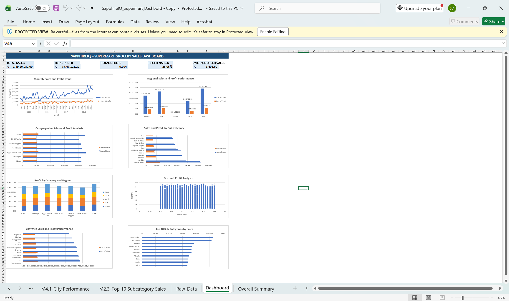

SapphireIQ – Supermart Grocery Sales Dashboard

Project Overview

SapphireIQ is an Excel-based grocery sales analysis project designed to understand supermarket sales performance, product profitability, discount impact, and regional trends.

Tools Used

- Microsoft Excel
- PivotTables and PivotCharts
- Excel formulas
- Data cleaning and analysis
- Interactive dashboard visualizations

Dataset

The project uses the Supermart Grocery Sales dataset containing 9,994 order records from 2015 to 2018.

Key Performance Indicators

- Total Sales: ₹14,956,982
- Total Profit: ₹3,747,121.20
- Total Orders: 9,994
- Profit Margin: 25.05%
- Average Order Value: ₹1,496.60

Key Insights

- Eggs, Meat & Fish recorded the highest category sales.
- Snacks generated the highest category profit.
- West was the highest sales-performing region.
- Kanyakumari recorded the highest city-wise sales.
- Health Drinks was the highest-selling sub-category.
- Discount and profit showed almost no linear correlation.

Dashboard Modules

1. Overall Sales Performance
2. Category Analysis
3. Monthly Sales and Profit Trends
4. Regional Analysis
5. Sub-Category Performance
6. Profit Ranking
7. Discount Analysis
8. City Performance

Project Objective

To transform raw grocery sales data into meaningful business insights and support data-driven decision-making.

Project File

"SapphireIQ_Supermart_Dashboard.xlsx"

Conclusion

This project demonstrates how Excel can be used to analyze retail sales data, identify business trends, evaluate profitability, and present insights through an interactive dashboard.
## Dashboard Preview

